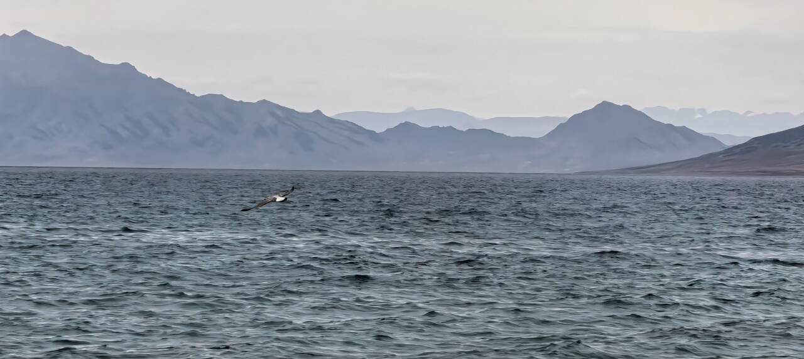
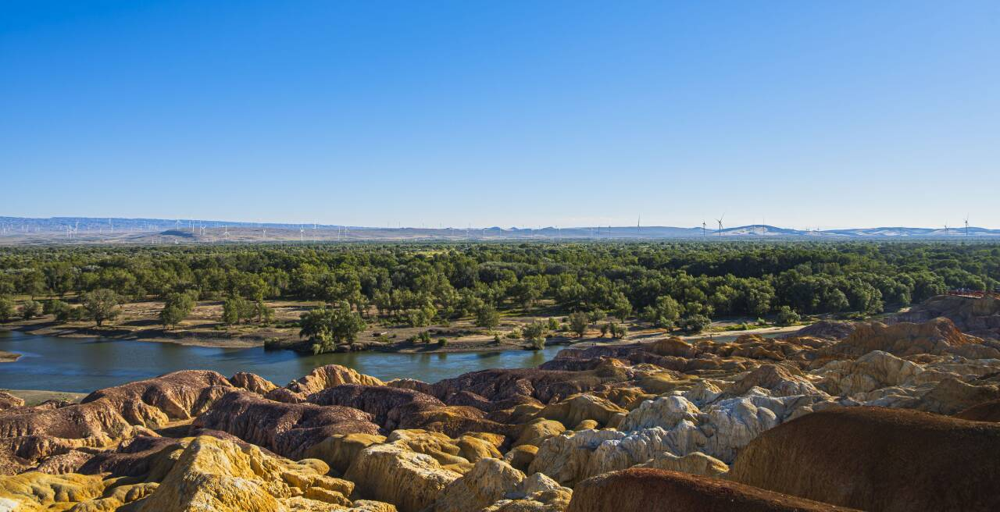
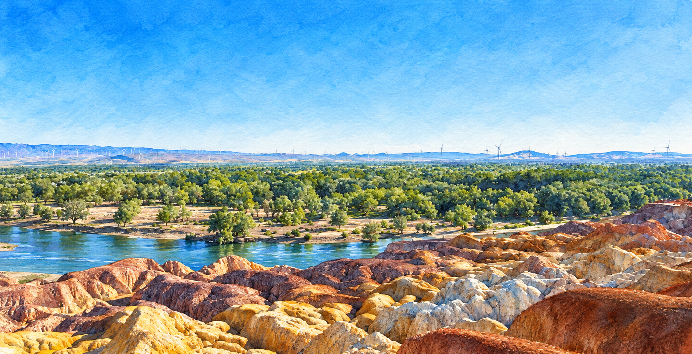
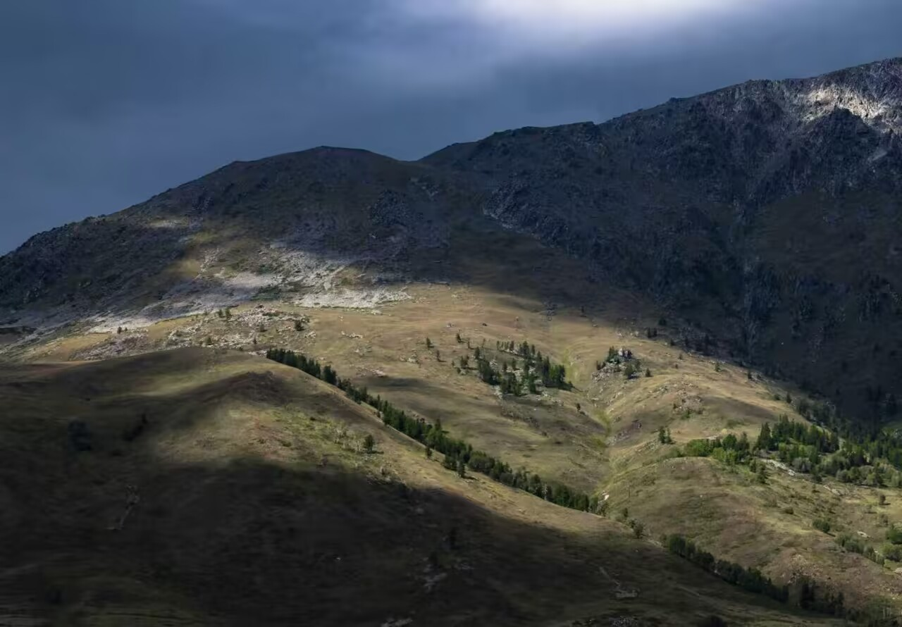
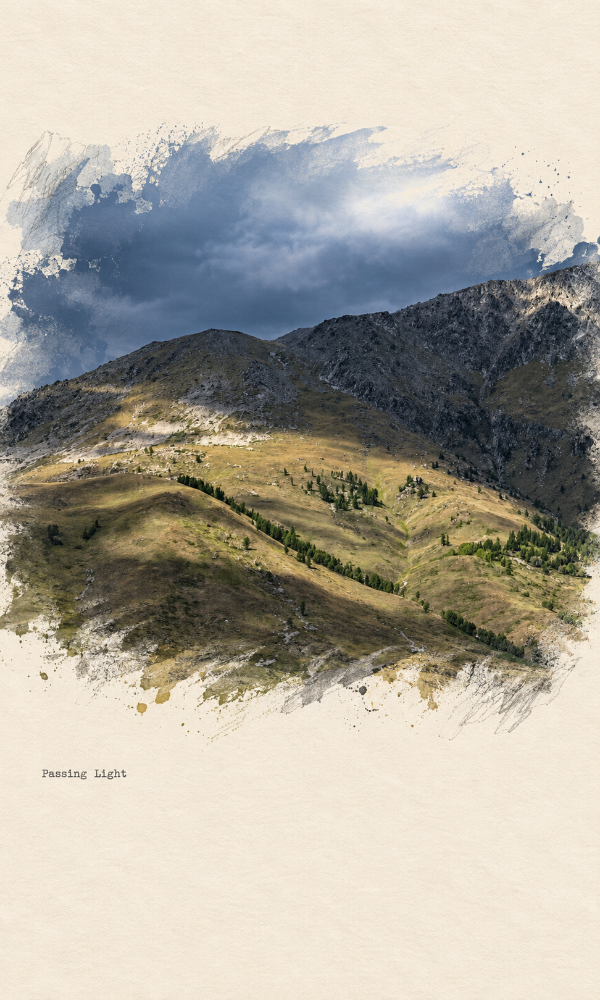

# Photo Style Studio

**一张原片，三种表达：地理旅行志、通透写实水彩、纸上摄影拼贴。**

上传摄影原片，选择风格，助手按对应分支处理。这是 Agent Skill 工作流，不是独立修图应用，也不内置图像模型或地图服务。

> **实际效果展示**：以下三组成品于 2026-10-26 按对应分支制作，经用户授权与对应原片并排展示。点击图片可查看大图；不包含此前的风格参考图。

## 先选一种风格

| | 地理旅行志 | 通透写实水彩 | 纸上摄影拼贴 |
| --- | --- | --- | --- |
| 最终观感 | 摄影作品＋透明细线地图 | 原场景转译成纸上水彩 | 摄影主体＋绘画边缘＋暖纸留白 |
| 处理方式 | 锁定原图，独立图层合成 | 全图绘画化重绘 | 核心保留摄影质感，外围局部绘画化 |
| 适合原片 | 有天空、海面等负空间的旅行摄影 | 建筑、湖景、园林与日常风景 | 有清晰主体、光影或倒影的摄影 |
| 输入与默认 | 地点、地图摆放区域 | 确认拍摄季节 | 默认竖版暖纸、自动边缘、小字标题 |
| 保留重点 | 原始像素、构图、色彩和光影 | 构图、主体、人物关系与季节 | 主体结构、摄影质感与可见季节 |

## 01 地理旅行志 · Geo Editorial

**照片是主角，地图为它补充地点与旅行感。**

| 原片 | 地理旅行志成品 |
| :---: | :---: |
| [](docs/images/sayram-lake-original.jpg) | [](docs/images/sayram-lake-editorial.png) |

*赛里木湖 · 右上天空独立透明叠层。红点表示湖区示意，不是精确拍摄位置。为避开山脊，本例缩小了地图布局。*

地图轮廓来自 [OpenStreetMap relation 35887](https://www.openstreetmap.org/relation/35887)，© OpenStreetMap contributors，数据采用 [ODbL](https://www.openstreetmap.org/copyright) 许可。

目标效果：没有矩形底板的透明地图、少量地名、细线条和小红点。地图融入负空间，避免遮挡主体。

- **位置由你选择**：四个角、自定义区域，或自动安排，不默认右上角。
- **地图有真实依据**：按地点选择街道、海岸线或有来源的地形；只知城市时标注大致区域，不伪造 GPS。
- **原片保持完整**：不裁切、不改天空、不整图重绘；纸感只作用于新增图层。

整体排版克制，不添加大面积标题或多余装饰；地图几何需核实。

**试着这样说：**

> 使用 $photo-style-studio，把这张照片做成地理旅行志风格。拍摄地点是杭州，仅知道城市，没有 GPS。地图放左上角，保持原图完整。

**交付**：原比例成品、同尺寸透明叠层、实际分层素材、地图来源与位置精度说明。

[查看地理分支规则与提示词 →](skills/photo-style-studio/references/geo-editorial.md)

## 02 通透写实水彩 · Luminous Watercolor

**保留熟悉的场景，把光、树叶与水面变成透明叠染和细腻笔触。**

| 原片 | 通透写实水彩成品 |
| :---: | :---: |
| [](docs/images/summer-landscape-original.jpg) | [](docs/images/summer-landscape-watercolor.png) |

*夏季景观 · 满幅水彩。保留绿色植被、河道与岩丘的整体构图，以透明叠染、点染与干笔表现材质。*

本例使用内置图像生成工具转绘，输出为 1752 × 898，比例近似原片，未另行裁切或拉伸。绘画细节会变化，不承诺像素保真。

- **保留原有季节**：未说明时生成前询问；不确定则按原图可见特征，不擅自加秋叶、积雪或花朵。
- **秋季不等于必须黄叶**：原片仍是绿树，就保留绿树；参考图的金黄调色不自动迁移。
- **边缘可选**：默认满幅；明确选择纸边时，使用不规则水彩露白，不套矩形相框。
- **绘画化而非像素保真**：允许重绘，重点验收构图、主体结构、人物数量与位置、天气和主要光向。

**试着这样说：**

> 使用 $photo-style-studio，把这张照片转成通透写实水彩。拍摄于夏季，保留原有季节，满幅绘制。

选择纸边模式时，可以补充：**“使用不规则水彩纸边，保留主体完整。”**

**交付**：水彩成品、实际生成提示词与验证说明，无需地图数据或透明地图叠层。

[查看水彩分支规则与完整提示词 →](skills/photo-style-studio/references/luminous-watercolor.md)

## 03 纸上摄影拼贴 · Paper Photo Collage

**让照片从细腻的摄影主体，逐渐过渡成纸上的颜料、干刷与线稿。**

| 原片 | 纸上摄影拼贴成品 |
| :---: | :---: |
| [](docs/images/mountain-original.jpg) | [](docs/images/mountain-paper-collage.png) |

*Passing Light · 暖纸承载山景，核心保留摄影质感，外围融入干刷、颗粒与少量线稿。*

本例采用生成式编辑，输出 972 × 1619，接近 3:5 竖版。暖纸、边缘与标题效果已体现，但山脊和云层细节存在变化，尚未严格做到原景等比嵌入；作为风格演示展示，不代表主体保真验收完全通过。

与第二类的整幅水彩不同，这一类保留核心区域的摄影细节，只在外围进行绘画化过渡。温暖象牙白纸底、不对称留白与一行小字形成纸面作品。

- **建筑场景**：边缘断续线稿、少量排线与色块擦印。
- **树林草地**：叶簇式色斑、轻微水渍与局部干刷飞溅。
- **湖面倒影**：顺着水波的横向断续笔触与露纸，保留倒影关系。
- **默认竖版 3:5**：等比摆放照片、增加纸面留白，不拉伸主体；也可指定保留原比例。
- **默认小字标题**：简短英文情绪标题，也可自定义或完全无字。季节保持原片，不把暖纸色变成秋色滤镜。

**试着这样说：**

> 使用 $photo-style-studio，把这张照片做成纸上摄影拼贴。保留摄影主体和原有季节，竖版暖纸，边缘自然融成干刷和色斑，小字标题用 Stillness。

**交付**：成品、实际提示词、所选画幅与边缘模式、验收说明；仅在实际分层制作时提供图层。

[查看第三分支规则与完整提示词 →](skills/photo-style-studio/references/paper-photo-collage.md)

## 安装与使用

1. 将 `skills/photo-style-studio/` 整个目录复制到助手支持的 skills 目录，不要只复制 `SKILL.md`。
2. 上传原片，说明想要的风格；如另附参考图，明确注明“这是风格参考”。
3. 回答对应分支的必要问题，助手执行处理并检查结果。

地理分支需要地图获取、矢量渲染和透明合成工具；水彩与纸上摄影拼贴需要支持原图编辑的图像工具。工具不足时会说明缺口，不将提示词或设计方案冒充已生成成品。

## 文件与扩展

```text
skills/photo-style-studio/
  SKILL.md                         # 风格入口
  references/
    geo-editorial.md                # 地理旅行志
    luminous-watercolor.md          # 通透写实水彩
    paper-photo-collage.md          # 纸上摄影拼贴
    delivery-contract.md            # 各分支交付与验收
    branch-contract.md              # 后续风格扩展规范
docs/images/                       # 三组原片与成品对比
tests/                             # 行为场景与验证记录
```

追加新风格时遵循 [分支接口](skills/photo-style-studio/references/branch-contract.md)，保持不同分支的保真要求独立。

## 验证与素材说明

已进行格式、引用、打包一致性及文本场景检查，并完成上述三张实际试制。地理成品保持原尺寸，叠层未覆盖区域逐像素一致；水彩成品已预览检查季节与整体构图；纸上摄影拼贴已展示媒介效果，主体几何保真仍有改进空间。这是三张示例的验证结果，不代表所有输入均已测试。详情见 [验证记录](tests/validation-notes.md)。

仓库包含用户授权展示的三张原片及对应演示成品，不包含此前的风格参考照片。图片仅用于效果对比，不作为安装后的自动生成输入；用户授权展示不等于授予第三方任意复用权。代码与文档的公开复用许可证待作者选择，地图数据遵循上列许可。
