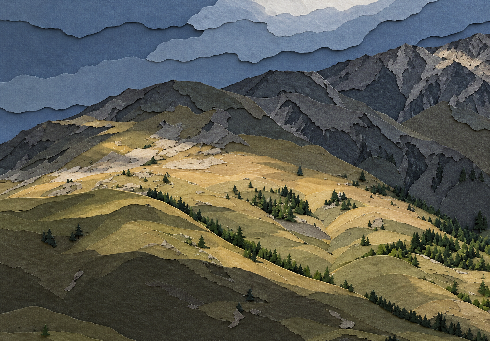

# Photo Style Studio

**Turn your photographs into travel editorials, watercolor paintings, paper collages, or layered paper reliefs.**

Upload a photo and choose a style. Photo Style Studio gives your AI assistant a workflow for making the edit and checking the result. You bring the assistant and its image tools; this repository supplies the instructions. No image model or map service is bundled.

The examples below pair original photographs with actual outputs. Click any image for a closer look.

## Choose a style

| Style | Look | Best suited to | Starting choices |
| --- | --- | --- | --- |
| Geo Editorial | Photography with fine-line maps | Travel photos with open sky, water, or other negative space | Location and map placement |
| Luminous Watercolor | Transparent washes and painterly detail | Architecture, gardens, lakes, and everyday landscapes | Season; painted edges or exposed paper |
| Paper Photo Collage | A photographic center fading into paint and paper | Clear subjects, striking light, and reflections | Portrait layout, warm paper, small caption |
| Layered Paper Relief | Overlapping paper shapes with visible depth | Mountains, woodland, and architecture | Original aspect ratio and palette, no text |

## 01 Geo Editorial

Fine map lines and a few place names give a photograph the feel of a travel journal. The map sits in the scene's negative space, with no rectangular card behind it.

| Original | Geo Editorial |
| :---: | :---: |
| [](docs/images/sayram-lake-original.jpg) | [](docs/images/sayram-lake-editorial.png) |

*Sayram Lake. The transparent map overlay is scaled down to clear the ridgeline. The red dot identifies the lake area, not the camera's exact position.*

Shoreline data: [OpenStreetMap relation 35887](https://www.openstreetmap.org/relation/35887), © OpenStreetMap contributors, licensed under the [ODbL](https://www.openstreetmap.org/copyright).

- **Choose the placement.** Pick a corner, describe a region, or let the assistant find a suitable space. It asks when placement has not been specified.
- **Use real geography.** Streets, coastlines, and terrain must come from identifiable sources. A city name can support a regional marker, but never invented GPS coordinates.
- **Keep the photo intact.** The base photo retains its framing, dimensions, color, and light. It is not cropped or repainted. Paper texture belongs to the added layers; pixels outside the overlay remain unchanged.

Labels, lines, and the small red marker stay understated. Large headlines and extra decoration are left out.

> Use $photo-style-studio to give this photo a Geo Editorial treatment. It was taken in Hangzhou, but I don't have GPS coordinates. Place the map in the upper-left corner and keep the original photo intact.

**You get:** the finished image, a matching transparent overlay, the layer assets actually used, and notes on map sources and location accuracy.

[Geo Editorial workflow and prompt →](skills/photo-style-studio/references/geo-editorial.md)

## 02 Luminous Watercolor

Transparent washes, dry-brush marks, and small touches of pigment turn the scene into a watercolor painting. The composition stays familiar while individual details take on a painted character.

| Original | Luminous Watercolor |
| :---: | :---: |
| [](docs/images/summer-landscape-original.jpg) | [](docs/images/summer-landscape-watercolor.png) |

*A summer landscape painted edge to edge, retaining the green vegetation, river, and overall arrangement of the rock formations.*

This generative edit is 1752 × 898 pixels, close to the source aspect ratio. It was not cropped or stretched afterward. Fine details change during repainting.

- **Keep the season.** The assistant asks when the photo was taken if you have not said. If you are unsure, it follows what is visible in the photo.
- **Follow the source foliage.** Green trees stay green, even in an autumn photograph. A golden reference image does not automatically turn the scene into fall foliage.
- **Choose the edges.** The default fills the canvas. You can request irregular watercolor edges that expose the paper, without adding a rectangular frame.
- **Check the scene.** Composition, subject structure, people and their positions, weather, and the main direction of light all matter. Pixel-for-pixel preservation is not part of this treatment.

> Use $photo-style-studio to turn this photo into a luminous, realistic watercolor. It was taken in summer. Keep the season and paint all the way to the edges.

For exposed paper, add: **“Use irregular watercolor edges, keeping the subject complete.”**

**You get:** the finished painting, the prompt used, and notes on the result. Map data and transparent map layers are not needed.

[Luminous Watercolor workflow and prompt →](skills/photo-style-studio/references/luminous-watercolor.md)

## 03 Paper Photo Collage

Photographic detail gives way to dry-brush marks, pigment, and loose linework at the edges. Warm ivory paper and asymmetric margins leave room for a small caption.

| Original | Paper Photo Collage |
| :---: | :---: |
| [](docs/images/mountain-original.jpg) | [](docs/images/mountain-paper-collage.png) |

*Passing Light. A photographic mountain scene meets dry-brush texture and sparse linework on warm paper.*

This generative edit is 972 × 1619 pixels, close to a 3:5 portrait format. It demonstrates the paper, edge treatment, and caption, but some ridge and cloud details have changed. The scene was not placed with exact proportional fidelity, so this example is a style demonstration rather than a fully faithful composite.

- **Architecture:** broken outlines, light hatching, and patches of rubbed color around the edges.
- **Trees and grass:** leaf-like pigment marks, light water blooms, and occasional dry-brush splashes.
- **Water and reflections:** broken horizontal strokes that follow the ripples, with paper showing through.
- **Layout:** a 3:5 portrait canvas by default. The intended method adds paper around a proportionally placed scene without stretching the subject. You can request the original aspect ratio instead.
- **Caption:** a short English title by default. Supply your own or leave it out. Warm paper should not change the season shown in the photo.

> Use $photo-style-studio to make a paper photo collage. Keep the subject photographic and preserve the season. Use a portrait layout on warm paper, with edges fading into dry-brush marks and pigment. Add a small caption: Stillness.

**You get:** the finished image, the prompt used, and notes on the layout, edge treatment, and checks. Editable layers are supplied only when they were actually created.

[Paper Photo Collage workflow and prompt →](skills/photo-style-studio/references/paper-photo-collage.md)

## 04 Layered Paper Relief

Hills, trees, and clouds become overlapping shapes of matte paper. Visible edges, subtle thickness, and small shadows between layers give the scene depth.

| Original | Layered Paper Relief |
| :---: | :---: |
| [](docs/images/mountain-original.jpg) | [](docs/images/mountain-layered-paper.png) |

*The whole landscape is rendered as paper, with cut edges and gentle contact shadows separating the layers.*

The default keeps the original aspect ratio, draws its palette from the photo, and preserves the visible season and main lighting pattern. No text is added. Rock faces, tree groups, and clouds may be simplified; exact geometry and pixel fidelity are not guaranteed. The result is a generated image of a paper relief, not an editable layer stack or a physical cutting template.

> Use $photo-style-studio to turn this photo into a layered paper relief. Keep the original aspect ratio, season, and lighting. Use colors from the photo and leave out any text.

**You get:** the finished image, the prompt used, and notes on settings and checks.

[Layered Paper Relief workflow and prompt →](skills/photo-style-studio/references/layered-paper-relief.md)

## Installation and use

1. Copy the entire `skills/photo-style-studio/` folder into your assistant's supported skills directory. Include the reference files, not just `SKILL.md`.
2. Upload your original photo and name the style you want. Label any additional images as style references.
3. Answer any questions needed for that style, then let the assistant create and check the result.

Geo Editorial requires access to map data, vector rendering, and transparent compositing. The other three styles require an image tool that can edit from a reference photo. If the tools are unavailable, the assistant should explain what is missing and provide a prompt or plan without claiming to have made an image.

This README is in English. The detailed skill instructions and most supporting documentation are currently in Chinese.

## Repository layout

```text
skills/photo-style-studio/
  SKILL.md                         # Style selection and shared rules
  references/
    geo-editorial.md                # Geographic editorial treatment
    luminous-watercolor.md          # Realistic watercolor
    paper-photo-collage.md          # Photography on warm paper
    layered-paper-relief.md         # Cut-paper relief
    delivery-contract.md            # Outputs and checks for each style
    branch-contract.md              # Guidelines for adding styles
docs/images/                       # Four comparisons using three source photos
tests/                             # Behavior scenarios and validation notes
```

To add a style, follow the [branch contract](skills/photo-style-studio/references/branch-contract.md). Keep its preservation requirements separate from those of the existing styles.

## Validation and image use

Checks cover skill formatting, links, package consistency, and selected text-based scenarios. The first three image examples were made on October 26, 2026; the paper relief was made on October 29, 2026. All four were approved for display alongside their source photographs.

The geographic edit retains the source dimensions, and pixels outside the overlay were verified unchanged. The watercolor was visually checked for season and overall composition. The photo collage captures the intended materials but still has geometric differences from the source. The paper relief shows layers and shadows while simplifying trees and rock details. These findings apply to the examples shown, not to every possible input. See the [validation notes](tests/validation-notes.md).

The repository includes three original photographs and four demonstration outputs shared with permission. Earlier style-reference images are not included. The examples are for comparison and are not used as automatic inputs after installation. Permission to display them does not grant unrestricted reuse. A reuse license for the code and documentation has not yet been chosen; the map data is subject to the license credited above.
